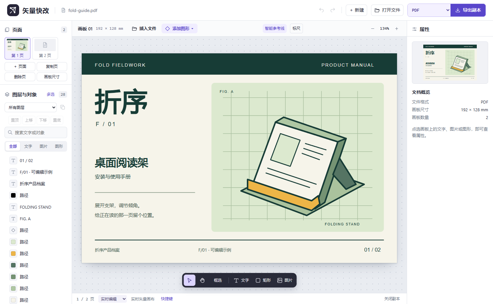

# Vector Workbench · 矢量快改

Edit a product manual directly on the artboard. Open a PDF, change a heading, move a clipped photo or resize a group, then export your pages as an editable PDF. The browser edition processes documents on the visitor’s device.

**[Open the live editor](https://vector.zhangshuo.work/)** · **[Download for Windows x64](https://github.com/shuoshuowa/vector-workbench/releases/latest/download/VectorWorkbench-Windows-x64.zip)** · **[Download the two-page sample](https://raw.githubusercontent.com/shuoshuowa/vector-workbench/main/examples/fold-guide.pdf)** · [Latest release](https://github.com/shuoshuowa/vector-workbench/releases/latest) · [中文](README.md)

[](https://vector.zhangshuo.work/)

Open the sample, switch to page two and double-click the heading. Type on the artboard, drag the text frame to reflow the paragraph, or switch to its object handles to scale the lettering. Alt-drag duplicates a selection. The layer panel supports drag-to-reorder and the inspector supports multi-object sizing, alignment and text style transfer.

**Formats.** The browser edition opens PDF, PDF-compatible AI, EPS, SVG and supported PSD files. It exports multi-page PDF and current-artboard SVG/EPS, layered RGB PSD or multi-artboard PSD. EPS outlines text. Some PSD elements rasterize. Outlined text in an input file remains a path; complex transparency, effects and unavailable fonts can affect fidelity. Illustrator can split exported PDF text into lines or font runs. Use Shift+O to arrange named artboards and the Illustrator transfer ZIP to rebuild their positions and editable gradient text in Illustrator. The separate Illustrator integration uses an installed, licensed copy of Illustrator for native AI export.

## Windows desktop app

Extract the entire portable ZIP, then launch **VectorWorkbench.exe** on Windows 10 or 11 x64. The editor runs offline using Microsoft Edge WebView2 Runtime. Fonts, format libraries and the example PDF are included. Export opens a native Save As dialog. To rebuild, run `pwsh -File windows/package.ps1` on Windows with Node.js 22+ and PowerShell 7.

## Run locally

With Node.js 22+:

```sh
git clone https://github.com/shuoshuowa/vector-workbench.git
cd vector-workbench/online
npm ci --omit=optional --ignore-scripts
npm run build
npm start
```

Visit **http://127.0.0.1:4173/**. The generated `online/dist/` can be hosted as a static HTTPS site. For the Windows/Illustrator edition run `node server.cjs` at the repository root.

## Source and commercial licensing

Copyright © 2026 **shuoshuowa**. Original project code, documentation and examples are source-available under the **PolyForm Noncommercial License 1.0.0**. Commercial use requires separate written permission from the rights holder. Please describe your proposed use and distribution when you [email shuoshuowa@gmail.com](mailto:shuoshuowa@gmail.com?subject=Vector%20Workbench%20Commercial%20License).

[License](LICENSE) · [Required notice](NOTICE) · [Third-party terms](THIRD_PARTY_NOTICES.md)
