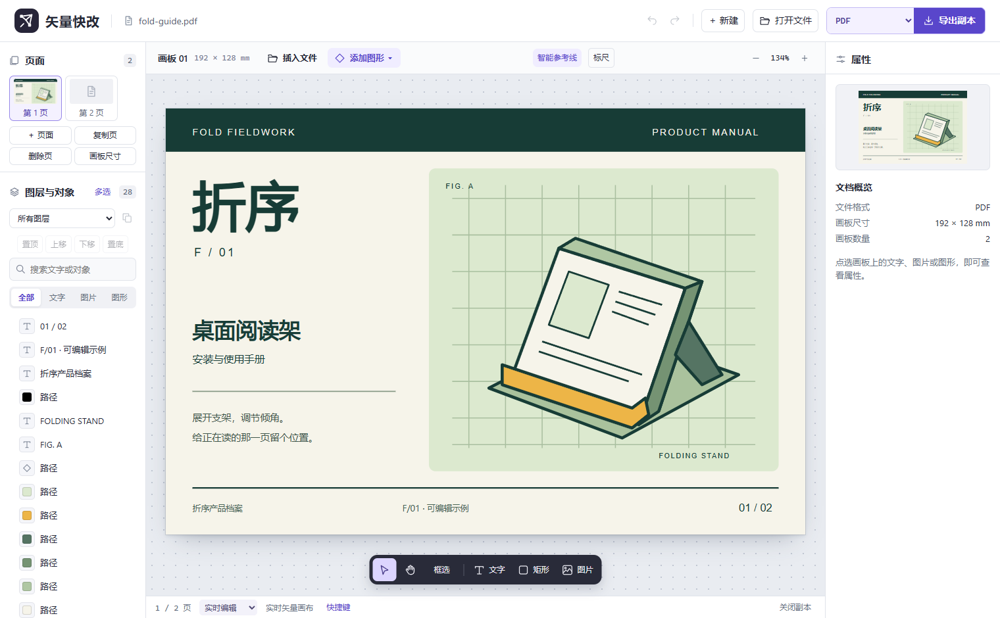
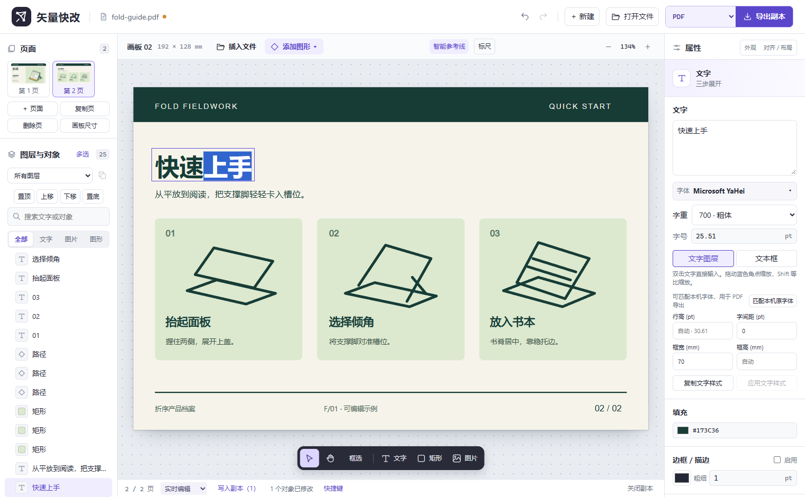
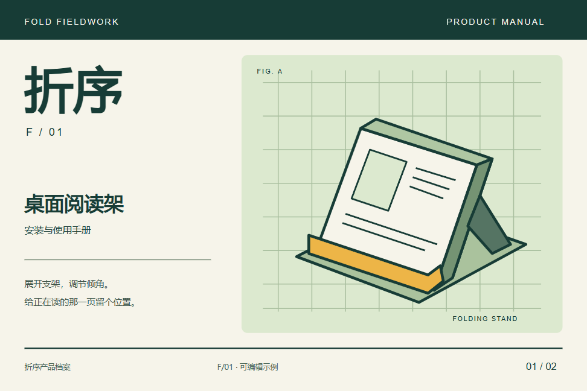
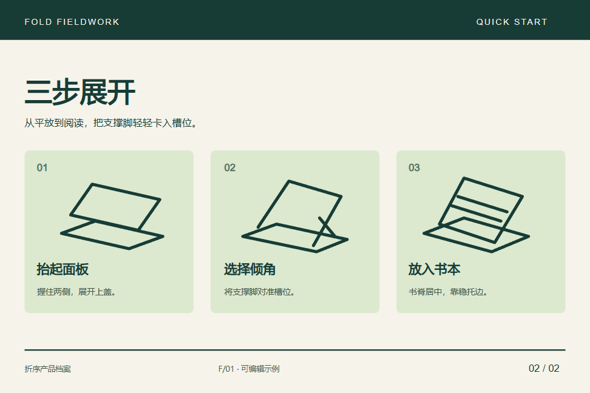
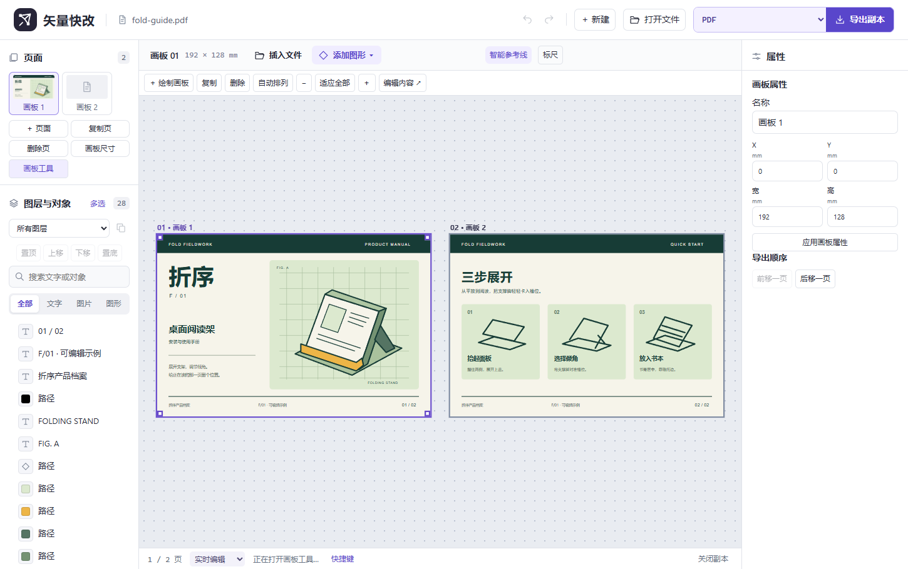

# 矢量快改 · Vector Workbench

在浏览器里改说明书、包装稿和多页 PDF。双击画板上的文字就能改字，拖动文本框就能重新排版，完成后导出一份副本。文件和编辑记录留在当前浏览器。

**[打开在线工作台](https://vector.zhangshuo.work/)**　·　**[下载两页示例 PDF](https://raw.githubusercontent.com/shuoshuowa/vector-workbench/main/examples/fold-guide.pdf)**　·　[本地运行](#本地运行)　·　[English](README.en.md)

[](https://vector.zhangshuo.work/)

## 用一份说明书试试

1. 下载上面的《折序 F/01》示例，把 PDF 拖进工作台。
2. 切到第 2 页，双击 **「三步展开」**，把它改成 **「快速上手」**。按 `Enter` 手动换行，点击框外完成编辑。
3. 选中正文，在右侧切换到 **「文本框」**，拖绿边调整框宽；切换到 **「文字图层」**，拖蓝色角点缩放文字。
4. 右上角选 **PDF → 导出副本**，两页会一起导出。重新打开副本，还可以接着改。



| 封面 · 矢量产品插画 | 内页 · 分步图解 |
| --- | --- |
| [](examples/fold-cover.svg) | [](examples/fold-instructions.svg) |

示例的插画、色块和文字都可以选中。点上面的图片可查看对应的 SVG 源稿。

## 排版时能做什么

| 想改的地方 | 操作 |
| --- | --- |
| 只改一段字 | 双击正文直接输入，支持中文输入法和按框宽换行。可调字体、字重、字号、行高、字间距，或把一段文字的样式应用到多段。 |
| 只保留照片的一部分 | 把矩形盖在想取的区域，选择 **从画板复制图片并原位裁切**。框内副本保留原图的位置、缩放和旋转。 |
| 摆齐或复制多个元素 | 框选或按住 Shift 点选，拖角点整体缩放。Alt 拖动复制，Shift + Alt 沿水平或垂直方向复制。支持对齐、等距分布和智能参考线。 |
| 调整前后遮挡 | 在左侧拖动对象排序，或用上移、下移、置顶和置底。 |
| 一份文件排多页 | 按 Shift+O 在同一工作区绘制、拖动、改名或排列画板。Alt 拖动复制画板；左侧顺序控制导出顺序。可选 mm、cm、in、pt 和 px，像素按 96 px/in 换算；Ctrl+R 切换标尺。 |



选中文字、矩形或路径后，属性栏的「混合选项」支持双色线性或径向渐变、投影、不透明度和混合模式。描边可调色、调粗细或关闭。

## 格式与编辑保真度

| 格式 | 浏览器打开 | 浏览器导出 |
| --- | --- | --- |
| PDF | 多页 | 全部画板；文字与矢量路径可继续编辑 |
| AI | 含 PDF 兼容内容的文件；部分旧式 PostScript 文件也可读取 | 继续在 Illustrator 工作可导出 PDF 或 SVG。也可导出 Illustrator 画板包，在 AI 里还原位置和名称后另存为原生文件 |
| SVG | 是 | 当前画板 |
| EPS | 通过本地运行的 WebAssembly 转换器 | 当前画板，文字转为轮廓 |
| PSD | 支持的 PSD 文字、像素图层及组 | 当前画板，或包含全部原生画板组的 RGB PSD；部分矢量对象转为像素 |

PDF 的效果取决于原稿。可读取的文字支持改写；已经转曲的文字按路径编辑，照片里的文字按像素处理。复杂透明蒙版、混合模式以及 PSD 特效可能出现差异。浏览器会使用可用的内嵌字形，新增字符缺字时可选择 **匹配本机原字体**。在 Illustrator 打开导出 PDF 时，部分正文会按行或字体段显示。工作台导出的 PDF 带有可供本项目恢复编辑的画板数据。

## 本地运行

安装 **Node.js 22 或更高版本** 后，在终端运行以下命令。

```sh
git clone https://github.com/shuoshuowa/vector-workbench.git
cd vector-workbench/online
npm ci --omit=optional --ignore-scripts
npm run build
npm start
```

打开 **http://127.0.0.1:4173/**。构建需要先下载 npm 依赖；构建完成后，网页、中文字体和格式组件都在 `online/dist/` 内，可在断网时通过本机服务使用。修改源码后再运行一次 `npm run build`。

**自行托管**　把 `online/dist/` 部署到支持静态文件的 HTTPS 服务。使用 Cloudflare Workers Static Assets 时在 `online/` 运行 `npx wrangler login` 和 `npx wrangler deploy`。仓库中的配置使用通用 Worker 名称，可替换成自己的名称。使用其他服务器时请配置 `.js`、`.wasm` 的 MIME 类型，并应用 `dist/_headers` 中的响应头。

**Windows + Illustrator 本机版**　电脑已安装 Node.js 和已激活的 Adobe Illustrator 时，可在仓库根目录运行 `node server.cjs`，或双击 `启动矢量快改.vbs`。此版本通过本机 Illustrator 处理设计稿，并支持原生 AI 导出。[两种运行方式与常见问题](docs/usage.md)

## 隐私与保存

在线工作台从静态站点加载程序，在访问者的浏览器里解析和导出文件。访问本机字体时由浏览器询问权限。当前标签页可通过本地浏览器存储恢复部分工作状态；跨设备使用、长期归档或交付请下载导出文件。清除站点数据会删除本地缓存。

## 版权与商用

© 2026 **shuoshuowa**。项目采用**源码公开、非商业许可**。原创代码、说明和示例按 **PolyForm Noncommercial 1.0.0** 提供。个人非商业学习、试用及符合许可的修改和分享可直接进行，分发时请保留许可与版权声明。[许可全文](LICENSE) · [版权声明](NOTICE)

**商用请先取得书面授权**。企业生产使用、收费服务、为客户交付的商业项目或集成进商业产品，可邮件说明用途、使用范围和是否需要再分发。**[联系 shuoshuowa@gmail.com](mailto:shuoshuowa@gmail.com?subject=Vector%20Workbench%20Commercial%20License)**

你导入的设计稿及其内容仍由各自权利人享有权利。第三方字体、库和转换器有独立许可；商用联系仅涉及作者有权授权的部分。[第三方许可与来源](THIRD_PARTY_NOTICES.md)
